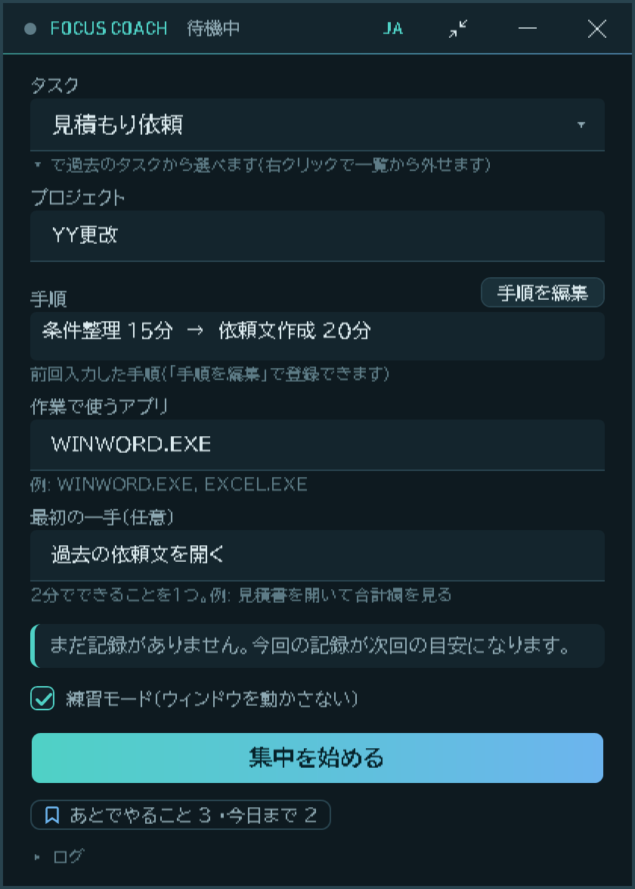
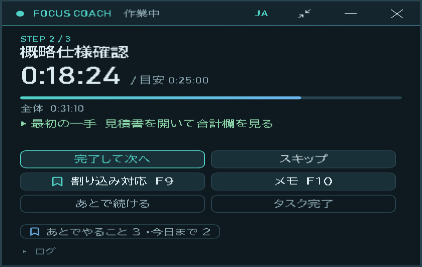
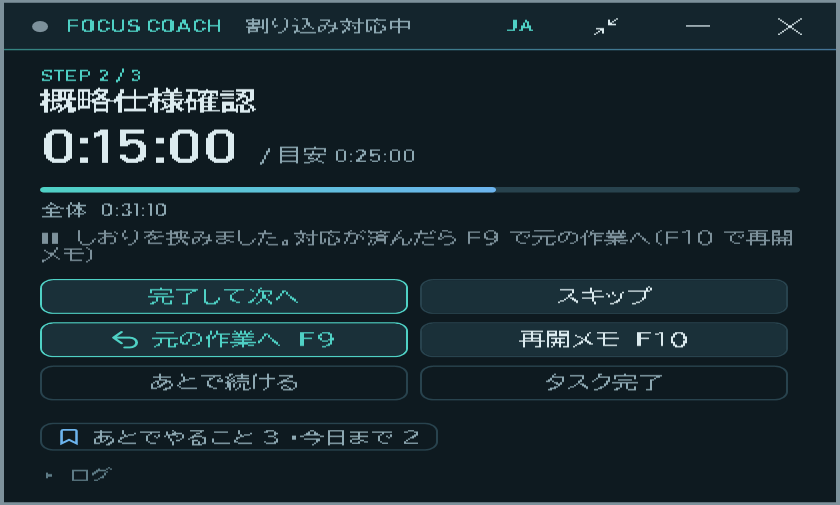
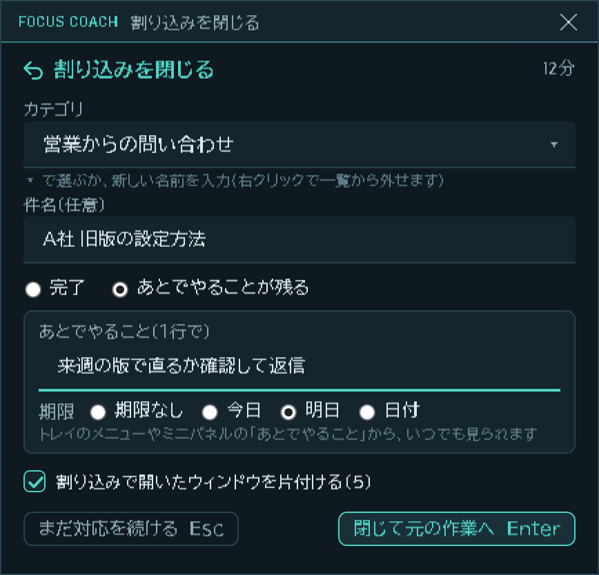
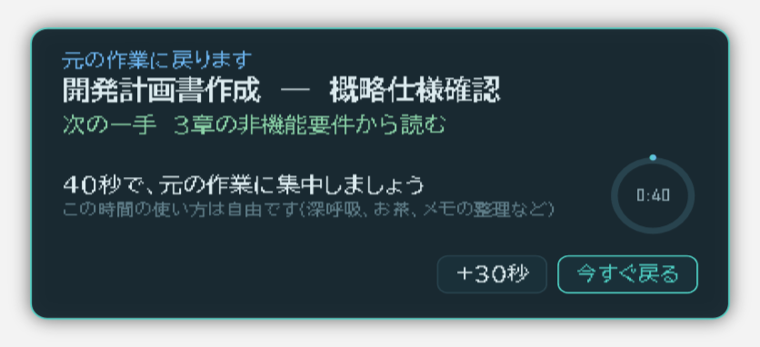
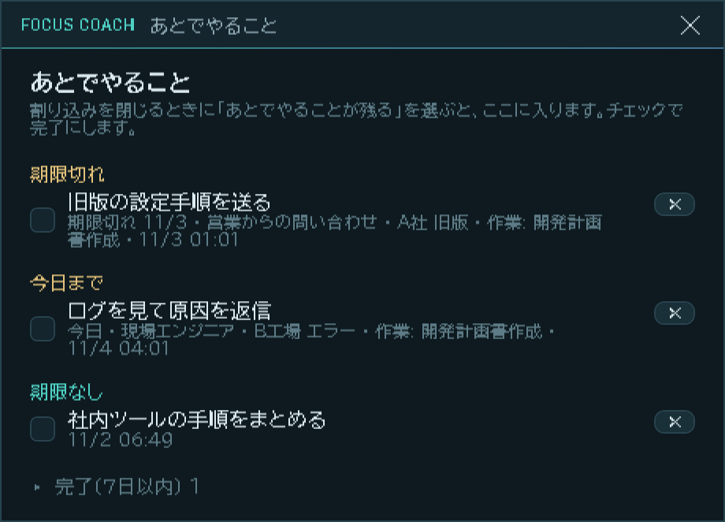

# FocusCoach

[English README](README.md)

複数のツールを使うルーチンワークを、**サブタスクの順序と予想時間に分解**し、作業に集中できる環境を作る Windows アプリ。
作業の割り込みが入ったときに、**元の作業へ素早く戻って、再び集中できる**ように支援する。

Windows PC での定型業務(例:開発計画書の作成)を、過去の同種タスクの実績をもとにガイドする。
主眼は、割り込みで中断した作業へ短時間で戻れるようにすること(中断の前に文脈を退避し、戻るときに復元する)。
ほかに、タスク専用ワークスペース、サブタスクごとの時間と参照資料の自動記録、前回との比較による振り返りを備える。

## 現在の状態

**プロトタイプ(0.14A)。** 開始準備(空から始まる、過去のタスクから選ぶプルダウン、手順の登録、入力の下書き保存)と、
作業中のミニパネル(割り込み F9 / メモ F10、離席・ロックの問いかけ、復帰カード、次の一手・最初の一手、
異常終了・翌日からの再開、ワークスペースの最小化と復元)、コンパクト表示(F8。元のウィンドウの左上を起点に縮み、半透明で、下のアプリをクリックできる)、最小化でタスクトレイに格納、アプリのアイコンが動く・付く。0.12A で、割り込み対応(しおり)→ 出口カードで閉じる → 40秒の再入場ガイドで元の作業へ、の流れと、タスクをまたいで残る「あとでやること」、アプリと同じ見た目のダイアログを追加。0.13A で、**英語表示**(日本語 ⇄ English)に対応した(タイトル帯の JA / EN ボタン、トレイのメニュー、Ctrl+Alt+F8)。0.14A で、同じ作者の Secrypt と同じ SPIRE デザインの起動画面を追加。
自宅PCで主な操作を確認済み。振り返りの画面、資料ランチャー、BGM・演出・音声メモは未実装。進捗と次の作業は [docs/plan.md](docs/plan.md) を参照。

## 使い方

割り込まれたら <kbd>F9</kbd>、終わったらもう一度 <kbd>F9</kbd>。これが基本です。下の画面は、サンプルデータでアプリから描画したものです。

<table>
<tr>
<td width="240" valign="top"></td>
<td valign="top">
<b>1. タスクを始める</b><br>
タスク名を入力するか、▾ で過去のタスクを選びます。手順と「最初の一手」が前回の内容で入り、ガイドには過去の実績から出した目標時間が出ます。「集中を始める」を押します。最初は<b>練習モード</b>(ウィンドウを動かさない)です。作業用ウィンドウの整理を使うときだけ、チェックを外してください。
</td>
</tr>
<tr>
<td width="320" valign="top"></td>
<td valign="top">
<b>2. ミニパネルで作業する</b><br>
今の手順と、目安に対するタイマーが出ます。「完了して次へ」で進み、「メモ」(<kbd>F10</kbd>)で、タイマーを止めずにあとで対応することを書き留められます。
</td>
</tr>
<tr>
<td width="320" valign="top"></td>
<td valign="top">
<b>3. 割り込みが来たら <kbd>F9</kbd></b><br>
キーを 1 回押すだけ。入力も確認もありません。状態が「割り込み対応中」になり、作業時間の計測が止まります。そのまま対応してください。自分へのヒントを残すなら <kbd>F10</kbd> で、どこまで進んだかと次の一手を書きます。
</td>
</tr>
<tr>
<td width="320" valign="top"></td>
<td valign="top">
<b>4. 終わったらもう一度 <kbd>F9</kbd></b><br>
小さなカードが開きます。何も書かずに <kbd>Enter</kbd> で閉じられます。カテゴリを選び、残ったことは期限つきで 1 行書きます。「割り込みで開いたウィンドウを片付ける」は、割り込みで開いたウィンドウを最小化します(閉じません)。<kbd>Esc</kbd> は「まだ対応を続ける」です。
</td>
</tr>
<tr>
<td width="320" valign="top"></td>
<td valign="top">
<b>5. 元の作業へ</b><br>
元の作業ウィンドウが前に出て、自分で書いた「次の一手」と、落ち着いた 40 秒のカウントダウンが出ます。この間に何をするかは自由です。「今すぐ戻る」で待たずに戻れ、60 秒未満の割り込みでは出ません。キーボードのフォーカスは奪いません。
</td>
</tr>
<tr>
<td width="320" valign="top"></td>
<td valign="top">
<b>6. あとでやること</b><br>
残したものは、タスクをまたいで残る一覧に入ります(画面はサンプル)。ミニパネルの件数かトレイのメニューから開き、チェックで完了にします。
</td>
</tr>
</table>

画像つきの詳しい操作ガイド(日本語 / English。コンパクト表示・トレイ・キーを含む)は [docs/guide/index.html](docs/guide/index.html) です。GitHub では HTML がソースとして表示されるため、リポジトリを取得して、ブラウザで開いてください。

| キー | 動作 |
|---|---|
| <kbd>F9</kbd> | 割り込みのしおり / 割り込みを閉じる |
| <kbd>F10</kbd> | メモ(作業中)/ 再開メモ(割り込み中) |
| <kbd>F8</kbd> | コンパクト表示の切り替え |
| <kbd>Ctrl</kbd>+<kbd>Alt</kbd>+<kbd>F8</kbd> | 表示言語の切り替え(日本語 / English) |

キーは `settings.json`(データのフォルダ内)で変えられます。ほかのアプリが同じキーを使っているときは画面でお知らせします。ボタンでも同じ操作ができます。

## 動かし方(Windows)

```
dotnet build FocusCoach.sln
dotnet run --project src/FocusCoach.App
```

最初は「練習モード」(ウィンドウを動かさない)になっている。テストやシナリオの実行方法は [docs/plan.md](docs/plan.md) の「動かし方」を参照。

### 他の端末で使う(持ち運び版)

```
powershell -NoProfile -ExecutionPolicy Bypass -File scripts\publish-portable.ps1 -Dest E:\FocusCoach
```

.NET の実行環境ごと同梱するので、配布先の Windows 10/11 (64bit) には何もインストールしなくてよい(約 160MB)。使い方は [deploy/README.txt](deploy/README.txt)。

## 仕様書

章立てごとに `docs/spec/` 以下に分割している。読む順序は番号順を推奨。

1. [01-system-overview.md](docs/spec/01-system-overview.md) — システム概略
2. [02-components-environment.md](docs/spec/02-components-environment.md) — 構成要素・動作環境
3. [03-ui.md](docs/spec/03-ui.md) — UI仕様(画面のデザイン方針は §3.4.1)
4. [04-data.md](docs/spec/04-data.md) — データ仕様
5. [05-functions.md](docs/spec/05-functions.md) — 機能仕様
6. [06-ux.md](docs/spec/06-ux.md) — UX仕様
7. [07-tech-stack.md](docs/spec/07-tech-stack.md) — 技術選定・実装方針、実装状況
8. [08-debug-logging.md](docs/spec/08-debug-logging.md) — デバッグ性を考慮した設計、ログ設計方針
9. [09-focus-advice.md](docs/spec/09-focus-advice.md) — 中断からの復帰支援(旧: 集中切れアドバイスポップアップ)

## フォルダ構成

- `src/` — FocusCoach.Core(OS に依存しない中核)、Storage(SQLite・JSONL)、Platform.Windows(Win32 連携)、App(WPF の画面)、Cli(`fc`: シナリオ実行・リプレイ・診断)
- `tests/` — xUnit のテストと、`tests/scenarios/*.txt`(シナリオDSL)
- `docs/concept.md` — 構想イメージ原文(仕様の出発点。仕様と矛盾する場合は `docs/spec/` が正)
- `docs/spec/` — 仕様書本体(決定事項の正)
- `docs/plan.md` — 進捗、再開ポイント、次の作業
- `docs/review/` — レビュー、強化案、実機確認の記録
- `docs/Version.md` — バージョン履歴
- `CLAUDE.md` — Claude Code 向けのプロジェクト説明と作業ルール
- `deploy/` — 持ち運び版に同梱するファイル(起動用 .cmd と README)。`scripts/publish-portable.ps1` が使う
- `prototype/` — 画面の見た目の確認(`ui_render_probe`)とアイコン生成(`icon_gen`)の開発用ツール

## License

[MIT](LICENSE)。第三者の素材は [THIRD-PARTY-NOTICES.md](THIRD-PARTY-NOTICES.md) にまとめている。

## Version

[docs/Version.md](docs/Version.md) 参照。

## 第三者の素材

- 起動画面の書体 [Oxanium](https://github.com/sevmeyer/oxanium) と [Share Tech Mono](https://fonts.google.com/specimen/Share+Tech+Mono) は SIL Open Font License 1.1 で同梱している。ライセンス文は `src/FocusCoach.App/Fonts/*-OFL.txt`(配布物では `app\Fonts\`)。
