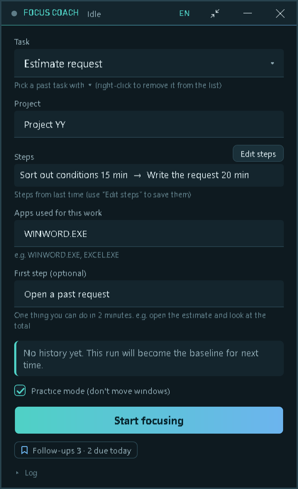
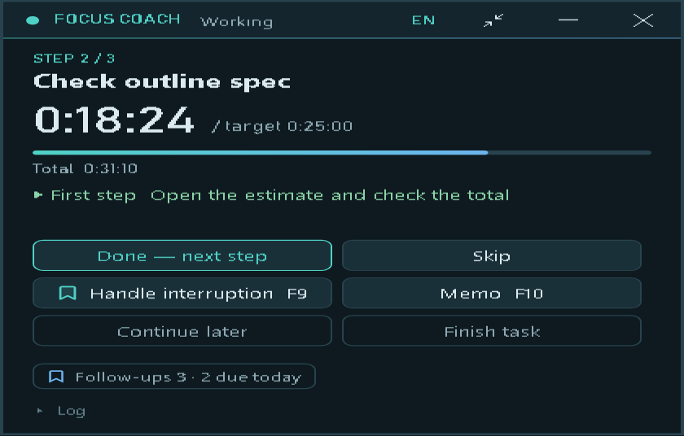
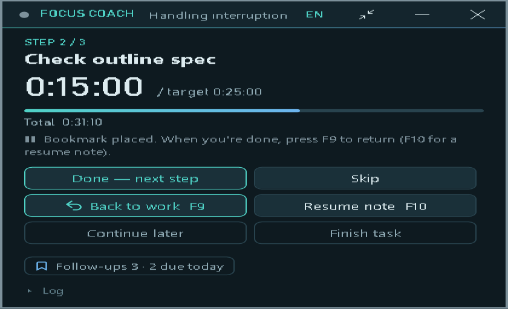
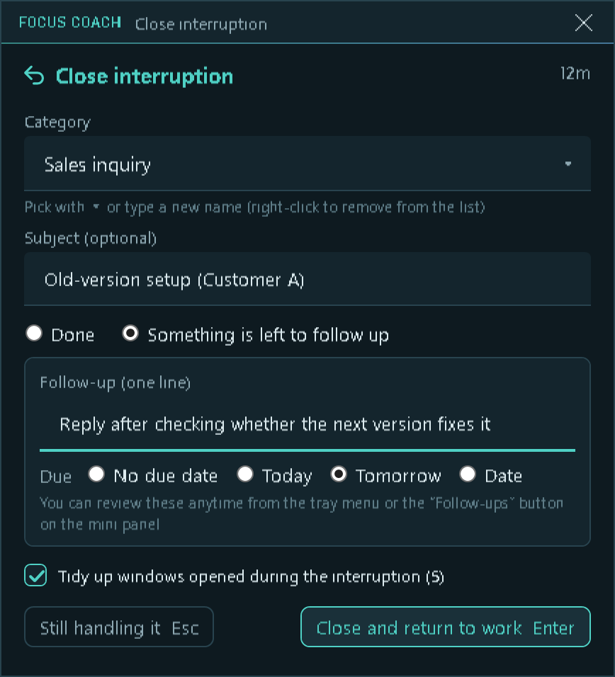
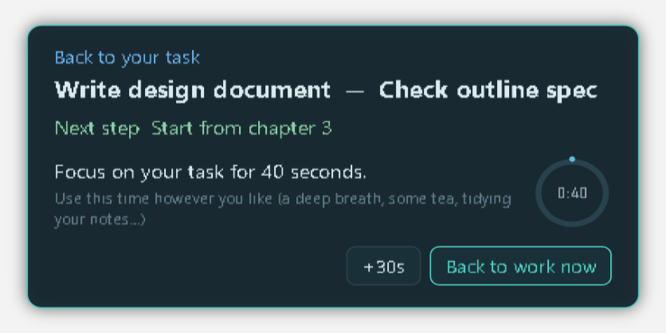
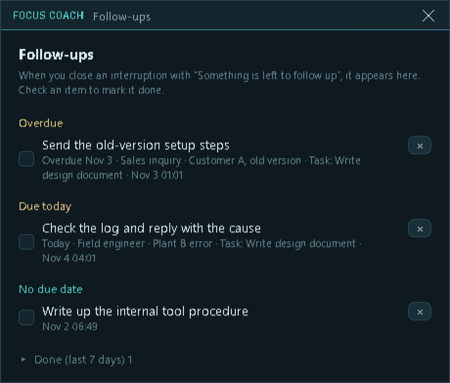

# FocusCoach

[日本語版 README](README.ja.md)

A Windows desktop app for routine work that spans several tools.

- It **breaks the routine into ordered sub-tasks with estimated times** (learned from your own past runs) and sets up an environment where you can concentrate on the work.
- It **helps you get back to work quickly after an interruption** and focus again.

When a colleague, a customer question or a chat message pulls you away from a task, the hard part is not the interruption itself - it is coming back: which windows were mine, where was I, what was the next step? FocusCoach saves that context before you leave and restores it when you return.

> **Status: prototype (version 0.14A).** It works end to end on the author's PCs, but it has had very little testing elsewhere. Please read [Known limitations](#known-limitations) first.

## What it does

- **Bookmark an interruption** with one key (`F9`) - no typing, no confirmation. Press it again when you are done.
- **Close the interruption** on a small card: pick a category, optionally write a subject, and if something is left over, jot it down as a *follow-up* with a due date. Pressing `Enter` closes it with nothing written.
- **Re-entry guide**: your original work window comes back to the front, with your own "next step" note and a short, calm countdown (40 s by default) before you are back in your task. What you do in those seconds is up to you.
- **Follow-ups list** that survives across tasks, stored locally.
- **Guided work sessions**: pick a past task, get a target time from your own history, track sub-steps, and compare with your previous runs.
- **Compact view** (`F8`): a small, translucent, click-through status strip that does not block the app underneath.
- **System tray**: minimize sends the app to the tray; the tray menu has the main actions.
- **Crash and next-day recovery**: an unfinished run can be resumed from where it stopped.
- **Japanese / English UI**: switch with the `JA`/`EN` button in the title bar, the tray menu, or `Ctrl+Alt+F8`.
- Screen sharing and recording **do not capture** the app's windows (task names and notes stay private).

Everything is stored **locally**. FocusCoach makes no network connections.

## Requirements

- Windows 10 or 11, 64-bit.
- The release ZIP is self-contained: nothing else to install, no administrator rights needed.

## Install (release ZIP)

1. Download `FocusCoach-<version>-win-x64.zip` and its `.sha256` file from the [Releases](../../releases) page.
2. Check the hash (PowerShell): `(Get-FileHash .\FocusCoach-<version>-win-x64.zip -Algorithm SHA256).Hash` and compare it with the `.sha256` file.
3. Unzip anywhere and double-click `FocusCoach.cmd`.
   `FocusCoach-portable.cmd` keeps all data in the folder's `data` subfolder instead (handy on a USB drive).

The executable is **not code-signed**, so Windows SmartScreen may warn you ("Windows protected your PC"). Choose *More info* -> *Run anyway* only if you trust the download and the hash matches. See `README.txt` inside the ZIP for details.

## Quick start

Press <kbd>F9</kbd> when you are interrupted, press it again when you are done. That is the whole idea. The screens below are rendered from the app with sample data.

<table>
<tr>
<td width="240" valign="top"></td>
<td valign="top">
<b>1. Start a task</b><br>
Type a task name, or pick a past one with the arrow. The steps and your "first step" note are filled in from last time, and the guide shows a target time learned from your history. Press <b>Start focusing</b>. The app starts in <b>Practice mode</b> (it does not move or minimize your windows); untick it only when you want the workspace features.
</td>
</tr>
<tr>
<td width="320" valign="top"></td>
<td valign="top">
<b>2. Work with the mini panel</b><br>
It shows the current step and a timer against its target. <b>Done - next step</b> moves on; <b>Memo</b> (<kbd>F10</kbd>) jots down something for later without stopping the timer.
</td>
</tr>
<tr>
<td width="320" valign="top"></td>
<td valign="top">
<b>3. An interruption arrives: press <kbd>F9</kbd></b><br>
One key press, no typing, no confirmation. The status changes to <i>Handling interruption</i> and the timer stops counting your work. Answer the question. If you want a hint for yourself, press <kbd>F10</kbd> and write where you were and your next step.
</td>
</tr>
<tr>
<td width="320" valign="top"></td>
<td valign="top">
<b>4. Done? Press <kbd>F9</kbd> again</b><br>
A small card opens. Just press <kbd>Enter</kbd> to close it with nothing written, or choose a category and, if something is left over, write it as a follow-up with a due date. <b>Tidy up windows</b> minimizes the windows the interruption opened (nothing is closed). <kbd>Esc</kbd> means "still handling it".
</td>
</tr>
<tr>
<td width="320" valign="top"></td>
<td valign="top">
<b>5. Back to your task</b><br>
Your original work window comes back to the front, with your own "next step" note and a calm 40-second countdown. What you do in those seconds is up to you. <i>Back to work now</i> skips the wait; interruptions under 60 seconds skip the guide. It never takes the keyboard focus.
</td>
</tr>
<tr>
<td width="320" valign="top"></td>
<td valign="top">
<b>6. Follow-ups</b><br>
Everything you left over stays in a list that survives across tasks (sample data shown). Open it from the counter on the mini panel or the tray menu; check an item to mark it done.
</td>
</tr>
</table>

The full illustrated guide (English / Japanese, with the compact view, tray and hotkeys) is [docs/guide/index.html](docs/guide/index.html). GitHub shows HTML files as source, so clone or download the repository and open it in a browser.

| Key | Action |
|---|---|
| <kbd>F9</kbd> | Interruption bookmark / close it |
| <kbd>F10</kbd> | Memo (while working) / resume note (during an interruption) |
| <kbd>F8</kbd> | Compact view on / off |
| <kbd>Ctrl</kbd>+<kbd>Alt</kbd>+<kbd>F8</kbd> | Switch language (Japanese / English) |

Hotkeys can be changed in `settings.json` (in the data folder). If another app already owns a key, FocusCoach says so and every action is still available by button.

## Build from source

Requirements: Windows, .NET 8 SDK.

```
dotnet build FocusCoach.sln
dotnet run --project src/FocusCoach.App
dotnet test FocusCoach.cloud.slnf        # unit tests and scenario tests (no UI)
```

To build the portable, self-contained folder: `scripts\publish-portable.ps1 -Dest <folder>`.

The code is organised so that nearly all behaviour is testable without a UI:

- `src/FocusCoach.Core` - OS-independent core: events, state, metrics, scenario DSL.
- `src/FocusCoach.Storage` - SQLite and JSONL session logs.
- `src/FocusCoach.Platform.Windows` - Win32 integration (window control, hotkeys, monitoring).
- `src/FocusCoach.App` - the WPF UI.
- `tests/` - xUnit tests and `tests/scenarios/*.txt` (a small text DSL that replays a work session headlessly).

UI strings live in `src/FocusCoach.Core/Strings/ja.json` and `en.json`; adding a language means adding a JSON file.

## Documentation

The specification and design notes are in **Japanese** (`docs/`). The UI is available in English, but the documents are not translated yet. Start at [docs/spec/01-system-overview.md](docs/spec/01-system-overview.md); the version history is in [docs/Version.md](docs/Version.md).

## Known limitations

- **Prototype quality.** It has been used on only a few Windows 11 PCs by one person. Expect rough edges.
- **Unsigned executable** (SmartScreen warning, see above).
- **Windows only** (WPF, Win32).
- **Workspace control** (minimizing/restoring other windows) is experimental; that is why Practice mode is on by default. The app never force-closes your windows.
- The system tray icon may be hidden under the `^` overflow arrow on Windows 11.
- Some planned features are **not implemented** (review screen polish, document launcher, background music, voice memos).
- The English text was written by an AI and may read unnaturally in places; corrections are welcome.
- Recorded data (window titles, file locations) is stored locally in plain form. Do not share the data folder or the logs.

## Built with AI

This project was developed with [Claude Code](https://claude.com/claude-code) (Anthropic), under the author's direction and review. The code, tests and documents were largely AI-generated.

## Security

See [SECURITY.md](SECURITY.md).

## License

[MIT](LICENSE). Third-party components are listed in [THIRD-PARTY-NOTICES.md](THIRD-PARTY-NOTICES.md).
